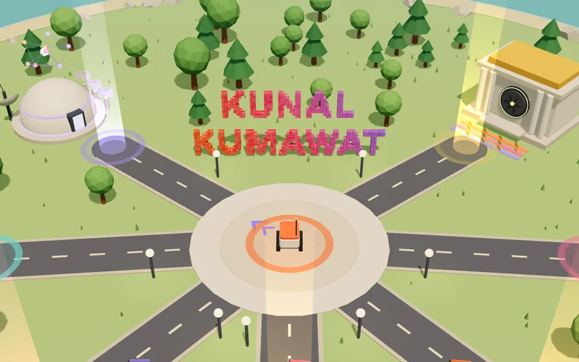

# Portfolio

My portfolio site: **[kunalkumawat.vercel.app](https://kunalkumawat.vercel.app)**

[](https://kunalkumawat.vercel.app)

The home page is a small 3D island you drive a little robot around. Each place on the island opens one part of my work. The same content is on a plain page at [/read](https://kunalkumawat.vercel.app/read) for anyone who just wants to read.

## How it is built

- **Next.js 16 + React 19 + TypeScript**, fully static (no server, no database).
- **React Three Fiber / three.js** for the island, with a small hand-written physics loop, no physics engine, for the robot you drive (`components/world/physics.ts`).
- **One content file** (`lib/content.ts`) feeds both the island and the read page, so they can never disagree.
- Day and night modes, and a read mode that works without WebGL.

## Run it

```bash
npm install
npm run dev:frontend
```

The site is in `apps/frontend`.
